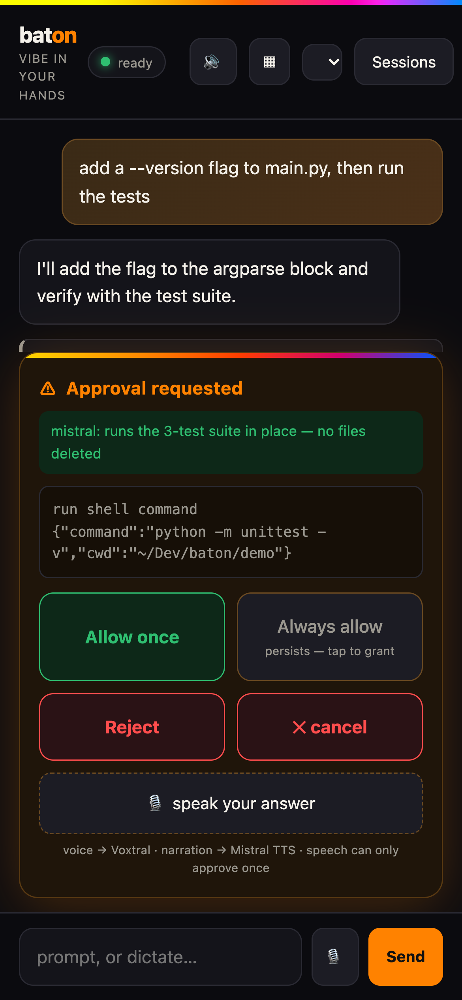

# baton 🏃

Pass the baton: drive **Mistral Vibe** from your phone. Native remote mode for
[mistral-vibe#1535](https://github.com/mistralai/mistral-vibe/issues/1535) —
built on `vibe-acp` (Agent Client Protocol), voice-native via **Voxtral**.

```
phone browser (PWA)  ──WebSocket──▶  baton  ──stdio/JSON-RPC──▶  vibe-acp
```

| your pocket | the room |
|---|---|
|  |  |

Every permission request hits the phone, the projector (`?stage`), and
every paired device at once — chime, vibration, live ticker, Mistral risk
annotation, Voxtral voice answers.

## Features

- List + resume sessions (`session/list` / `session/load`)
- Stream agent turns live (`session/update`)
- **Remote permission approvals** (`session/request_permission`) — tap, swipe,
  voice, or **nod/shake your face** (MediaPipe, allow-once only)
- **Three-tier trust policy** (allow/ask/deny, Claude Code-style) — deny rules
  refuse on your behalf (`.env`, keys, secrets never reach the phone), allow
  rules + Mistral-classified low-risk calls auto-pass, and one-way doors
  (`rm -rf`, force-push, drops…) always escalate to a human
- **Mistral risk adjudication** — every permission card gets a one-line
  plain-English summary + low/med/high verdict in ~0.5s
  (`mistral-small-latest` via chat completions; uses the Agents API when the
  key has access). The Vibe session itself runs the account's catalog model
  (`mistral-large-4-0`)
- Voice dictation for prompts + spoken approval answers (Voxtral)
- **Mission-control stage view** — open the URL with `?stage` on a projector:
  giant approval banner, LIVE event ticker, connected-device counter
- **Ambient state** — the top stripe shimmers while the agent works, pulses
  orange while it waits on you; chime + haptics on every request
- Auto-decisions broadcast to every device — the audit trail stays visible
- QR pairing over LAN, bearer-token auth
- **Pending approvals survive refresh/reconnect** — the bridge owns request
  state and replays it to any client that (re)connects; first answer wins,
  other clients' cards dismiss automatically
- Stop a running turn (`session/cancel`)

## Run

```bash
uv sync
./run.sh                          # sibling ../mistral-vibe clone (preferred)
./run.sh /path/to/vibe/fork       # the team's fork
MISTRAL_API_KEY=… ./run.sh        # or explicit key
```

Then open the printed URL on your phone, or use **Pair** on the authenticated
web page to show a QR code. The QR encodes the access token — only use it on a
trusted LAN and never share it. `/qr.png` requires the token and is not
publicly safe to expose.

**Voice needs HTTPS.** `getUserMedia` is blocked on `http://<lan-ip>` — over
plain LAN the mic button silently fails. For the voice demo run
`./tunnel.sh` (cloudflared) and open the printed
`https://*.trycloudflare.com/?token=…` URL instead. Tap approvals work fine
on plain HTTP.

`MISTRAL_API_KEY` is needed for baton's own Mistral calls (risk agent,
Voxtral). On macOS `run.sh` inherits the credential vibe-acp stored in the
`ai.mistral.vibe` keyring — a machine that already runs Vibe needs no env
vars. Vibe-side sessions use the auth and model configured in `~/.vibe`
(the account's catalog default, e.g. `mistral-large-4-0`).

**Telegram client (paused).** `tools/telegram_bridge.py` turns one private
chat into another baton device — bring your own bot:
[docs/telegram-setup.md](docs/telegram-setup.md) has the full walkthrough
(@BotFather token, chat-ID lookup, `.env`, launch, linking). Permission
requests arrive as messages with
inline Allow once / Deny buttons, plus `/new`, `/sessions`, `/stop`,
`/policy`, `/status` commands and direct replies. Routine tool activity
and streaming output stay in the browser. The Telegram picker resumes an
already-open Baton session without reloading its history. The integration is paused
pending the release gate in
[docs/telegram-integration-review.md](docs/telegram-integration-review.md) —
do not run it against real Telegram yet.

```bash
# .env (gitignored): TELEGRAM_BOT_TOKEN=… from @BotFather
#                    TELEGRAM_CHAT_ID=…  positive numeric id of the one
#                    authorized private chat (equals the operator's user id)
BATON_TOKEN=<token server.py printed> ./telegram.sh
# then /start the bot from that account — /start confirms access,
# it cannot grant it: only TELEGRAM_CHAT_ID authorizes anyone
```

`BATON_WS` / `BATON_HTTP` override the default `localhost:8765` endpoints.

**Testing / rehearsal drivers.** `tools/drive.py` creates a session and
prompts it (optionally `--auto-answer N`); `tools/task.py` prompts an
existing session id. Both print every protocol event — useful for a second
"laptop" participant or for verifying a new client sees cards replay.

If cloudflared can't reach its edge (some VPNs block argotunnel), any
TLS tunnel works — e.g. `ngrok http 8765` — the app only needs an `https://`
origin for mic/camera.

Config env vars: `PORT` (8765), `VIBE_ACP_CMD` (any command, see `run.sh`),
`BATON_TOKEN` (default: random per launch), `BATON_RISK_MODEL`
(default `mistral-small-latest`), `BATON_NO_AGENT` (skip Agents API).

## Integration contract (for teammates)

Baton needs **nothing** from the vibe fork beyond a working `vibe-acp`.
Whatever your branch adds surfaces automatically:

| Your feature | How it shows up in baton |
| --- | --- |
| New tools / tool calls | `session/update` → rendered as cards in the stream |
| New permission triggers | `session/request_permission` → phone approve/reject card |
| New modes | `session/set_mode` → mode picker, populated from `session/new` |
| Anything over MCP | configure on the session as usual (`mcpServers`) |

Test your branch against baton: `./run.sh /path/to/your/branch`, then:

- [ ] `session/new` returns a sessionId without errors
- [ ] a prompt produces streamed output on the phone
- [ ] your feature's permission prompt (if any) reaches the phone and
      approve/reject unblocks the agent
- [ ] `session/list` + resume still works

If it works over ACP, it works in baton. If your branch changes ACP methods
themselves, tell me — that's the one place we can conflict.

## Development

```bash
brew install gitleaks   # secrets scan runs as a local pre-commit hook
pre-commit install
pre-commit run --all-files
```

Hooks: ruff lint/format, yaml/toml/json hygiene, `detect-private-key`,
gitleaks. Never commit `MISTRAL_API_KEY` or `.env` — they stay in the
environment or `~/.vibe/.env`.

## Demo staging

`demo/` is a sacrificial toy repo the agent works in — never point the
demo at a real project. `demo/PROMPTS.md` has the canned prompt script:
what to send, what each one produces, and the fallback ladder.

## Prior art

Remote agent control exists (Paseo, Happier, HAPI — the issue author already
uses Paseo). Baton is deliberately narrower: a small, focused approval
console for Vibe that is reliable where a general-purpose UI breaks, and
voice-native via Mistral's own Voxtral rather than a bolted-on assistant.

## Demo story

Start a refactor at your desk → walk away → permission prompt vibrates on
your phone → say "yes, go ahead" → Voxtral transcribes → agent keeps working.

Demo prompt tip: commands already in `~/.vibe` bash allowlist (`ls`, `cat`,
`grep`, `git status`…) run without asking — that's the feature. To get a
card, prompt something outside it: `mkdir`, `curl`, `python`, `rm`, a file
write, or `git commit`.

## FAQ

**How does it get to my phone? Does Vibe need to run there?**
Nothing installs on the phone — it is just a browser. `run.sh` prints a URL;
open it (or use Pair on the authenticated page for the QR) and you're paired.
Vibe keeps running on the laptop the whole time: baton speaks
stdio/JSON-RPC to `vibe-acp` locally and plain WebSocket+JSON outward, so
execution stays local — only the *authority* moves. Note the privacy line is
narrower than "nothing leaves the machine": Telegram receives card details
and carries prompts you type there. Browser voice audio
and tool-call inputs go to Mistral for transcription and risk summaries.
Off-LAN, `./tunnel.sh` (cloudflared) gives an
`https://` URL, which voice/face need anyway since browsers block
`getUserMedia` on plain `http://` LAN origins.

**Could it work over Telegram / Slack / a watch?**
The bridge is just a WebSocket protocol — any client can subscribe to
permission requests and post answers; first answer wins and the other cards
dismiss. A Telegram client exists but is paused pending a security gate —
see above. The browser is the richest client, not the only one.

**Where are the extra features? How do I turn them on?**
- 🙆 **Face** — a "nod or shake your answer" button on every permission card.
  MediaPipe runs on-device in the phone browser; no frames leave the phone.
  Nod = approve once, shake = reject. Needs HTTPS (camera).
- 🎙 **Voice** — "speak your answer" → Voxtral transcribes → parsed to
  allow/deny. Voice and face can only approve *once*, never "always allow" —
  a deliberate safety bound.
- 🛡 **Trust dial** — the header toggle sets `auto_low` via
  `POST /api/policy`: Mistral-classified low-risk calls auto-pass, one-way
  doors (`rm -rf`, force-push, drops) always escalate, and deny rules
  (`.env`, `id_rsa`, secrets) are refused before they ever reach a client.
  Rule lists are settable through the same endpoint.

**What was there before vs. what baton adds?**
Vibe's `ask` mode holds the whole turn hostage until someone walks back to
the keyboard — approval latency is bounded by *your* commute to the desk;
the escape hatches are babysitting the terminal or blanket auto-approve.
Baton turns "wait until you're back" into "answered in ~10 seconds from
anywhere" — and policy turns blanket auto-approve into deny-lists, scoped
allow rules, and one-way-door escalation. Same `session/request_permission`
primitive; the session itself is untouched.
