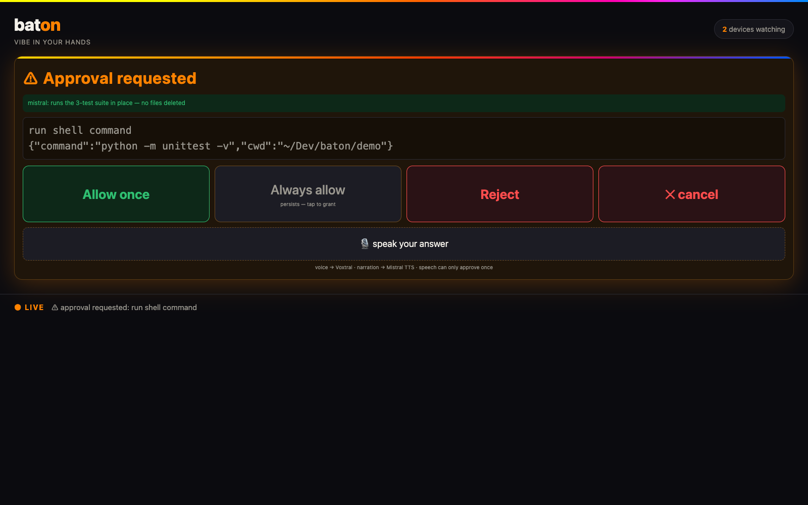

# baton 🏃

Pass the baton: drive **Mistral Vibe** from your phone. Native remote mode for
[mistral-vibe#1535](https://github.com/mistralai/mistral-vibe/issues/1535) —
built on `vibe-acp` (Agent Client Protocol), voice-native via **Voxtral**.

```
phone browser (PWA)  ──WebSocket──▶  baton  ──stdio/JSON-RPC──▶  vibe-acp
```

| your pocket | the room |
|---|---|
|  |  |

Every permission request hits the phone, the projector (`?stage`), and
every paired device at once — chime, vibration, live ticker, Mistral risk
annotation, Voxtral voice answers.

## Features

- List + resume sessions (`session/list` / `session/load`)
- Stream agent turns live (`session/update`)
- **Remote permission approvals** (`session/request_permission`) — tap, swipe,
  voice, or **nod/shake your face** (MediaPipe, allow-once only)
- **Three-tier trust policy** (allow/ask/deny, Claude Code-style) — deny rules
  refuse on your behalf (`.env`, keys, secrets never reach the phone), allow
  rules + Mistral-classified low-risk calls auto-pass, and one-way doors
  (`rm -rf`, force-push, drops…) always escalate to a human
- **Mistral risk line** on every approval card — one sentence + low/med/high,
  generated by a Mistral call (`/api/summarize`)
- Voice dictation for prompts (Voxtral)
- **Mistral Agent on Le Chonk** — risk adjudication runs as a persistent
  `baton-risk-assessor` agent (Agents + Conversations API, `mistral-large-latest`)
- QR pairing over LAN, bearer-token auth
- **Pending approvals survive refresh/reconnect** — the bridge owns request
  state and replays it to any client that (re)connects; first answer wins,
  other clients' cards dismiss automatically
- Stop a running turn (`session/cancel`)

## Run

```bash
uv sync
MISTRAL_API_KEY=… ./run.sh                      # stock vibe-acp
MISTRAL_API_KEY=… ./run.sh /path/to/vibe/fork   # the team's fork
```

Then open the printed URL on your phone (or scan `/qr.png` on the host).

**Voice needs HTTPS.** `getUserMedia` is blocked on `http://<lan-ip>` — over
plain LAN the mic button silently fails. For the voice demo run
`./tunnel.sh` (cloudflared) and open the printed
`https://*.trycloudflare.com/?token=…` URL instead. Tap approvals work fine
on plain HTTP.

Config env vars: `PORT` (8765), `VIBE_ACP_CMD` (any command, see `run.sh`),
`BATON_TOKEN` (default: random per launch).

## Integration contract (for teammates)

Baton needs **nothing** from the vibe fork beyond a working `vibe-acp`.
Whatever your branch adds surfaces automatically:

| Your feature | How it shows up in baton |
| --- | --- |
| New tools / tool calls | `session/update` → rendered as cards in the stream |
| New permission triggers | `session/request_permission` → phone approve/reject card |
| New modes | `session/set_mode` → mode picker, populated from `session/new` |
| Anything over MCP | configure on the session as usual (`mcpServers`) |

Test your branch against baton: `./run.sh /path/to/your/branch`, then:

- [ ] `session/new` returns a sessionId without errors
- [ ] a prompt produces streamed output on the phone
- [ ] your feature's permission prompt (if any) reaches the phone and
      approve/reject unblocks the agent
- [ ] `session/list` + resume still works

If it works over ACP, it works in baton. If your branch changes ACP methods
themselves, tell me — that's the one place we can conflict.

## Development

```bash
brew install gitleaks   # secrets scan runs as a local pre-commit hook
pre-commit install
pre-commit run --all-files
```

Hooks: ruff lint/format, yaml/toml/json hygiene, `detect-private-key`,
gitleaks. Never commit `MISTRAL_API_KEY` or `.env` — they stay in the
environment or `~/.vibe/.env`.

## Demo staging

`demo/` is a sacrificial toy repo the agent works in — never point the
demo at a real project. `demo/PROMPTS.md` has the canned prompt script:
what to send, what each one produces, and the fallback ladder.

## Prior art

Remote agent control exists (Paseo, Happier, HAPI — the issue author already
uses Paseo). Baton is deliberately narrower: a small, focused approval
console for Vibe that is reliable where a general-purpose UI breaks, and
voice-native via Mistral's own Voxtral rather than a bolted-on assistant.

## Demo story

Start a refactor at your desk → walk away → permission prompt vibrates on
your phone → say "yes, go ahead" → Voxtral transcribes → agent keeps working.
